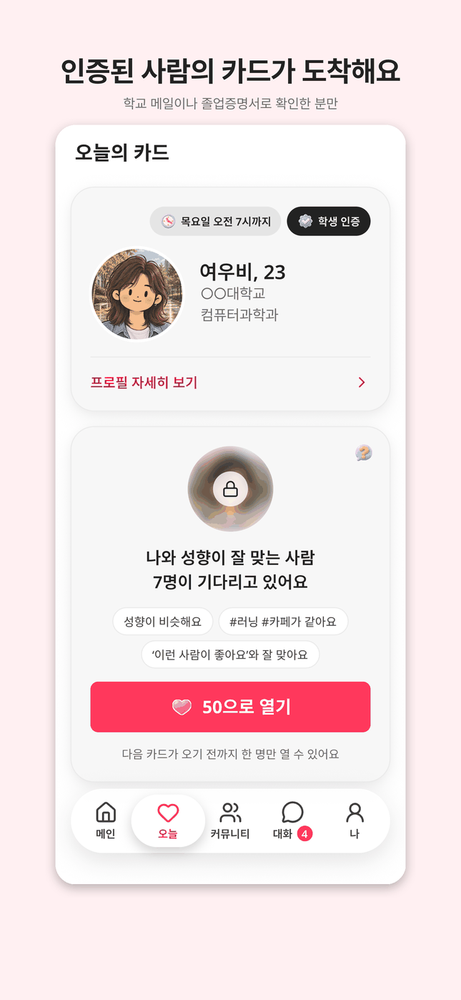
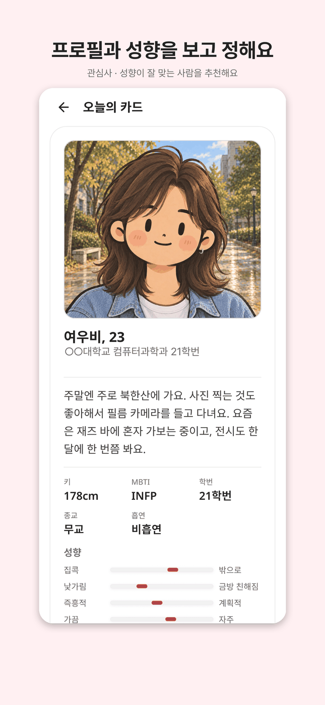
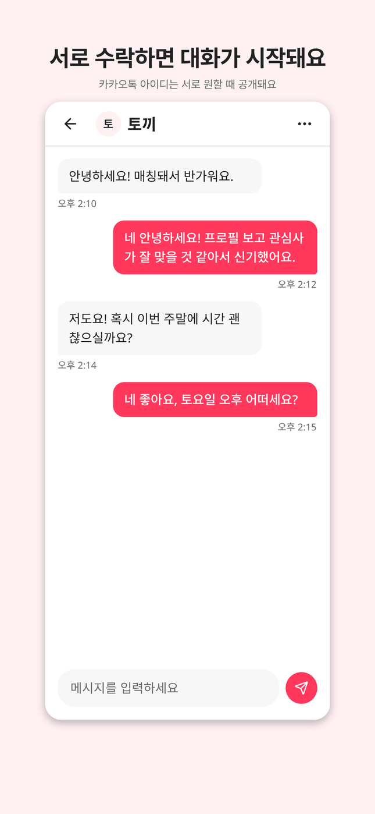
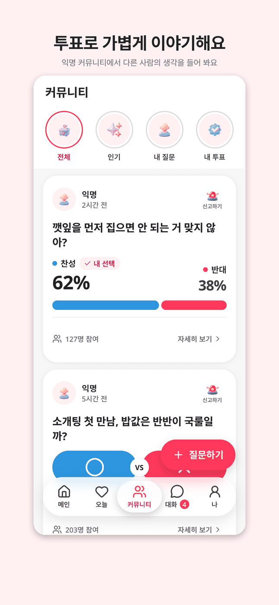

<div align="center">

# 💘 CampusMate

**나이 대신 잘 맞는 사람을 찾아 주는, 인증된 대학생 · 졸업생 매칭 앱**

<sub>2026.09 ~ · 개인 프로젝트 (앱 · 서버 · 관리자 웹) · 출시 준비 중</sub>


<br/><br/>

&nbsp;
&nbsp;
&nbsp;


</div>

<br/>

## 왜 만들었나

친구가 대학생 소개팅을 구글폼, 엑셀, 카톡으로 운영하고 있었어요. 신청자가 늘면 감당하기 어려워질 것 같아 웹으로 옮기자고 제안했고, 개발부터 운영까지 55일 동안 신청자 80명을 받았어요. 그런데 나이와 학교를 맞춰 줘도 이어지지 않는 쌍이 많았습니다. 매칭 성공률은 27.4%였어요.

그래서 질문을 바꿨어요.

> 나이가 맞으면 대화도 통할까? 무엇이 사람을 **잘 맞게** 할까?

CampusMate는 인증된 대학생과 졸업생에게 성향, 관심사, 자기소개 글의 뜻을 비교하고, 흡연이나 종교처럼 양보하기 어려운 조건은 감점으로 곱해 하루 한 명을 추천해요. 출시 전이라 정답 기록이 없어서, 정답표를 먼저 정하고 가상 계정으로 점수를 검증하며 고쳤습니다.

## 어떻게 쓰나

```
소셜 로그인 → 학교 인증 → 프로필 · 성향 입력 → 오늘의 카드 → 서로 수락 → 대화
```

- 학교 메일로 인증해요. 학교 메일이 없는 졸업생은 졸업증명서 사진을 올리면 관리자가 확인해요.
- 오늘 탭에 도착한 카드를 보고 수락해요. 두 사람이 서로 수락하면 대화가 시작돼요.
- 하트로 추가 카드를 열 수 있어요. 유료 카드는 점수 상위 20% 후보예요.
- 익명 커뮤니티에서 O/X 투표로 가볍게 이야기해요. 신고와 차단도 쓸 수 있어요.

## 내가 한 것

- 기획, 디자인, 앱, 서버, DB를 혼자 맡아 기획부터 두 스토어 제출까지 7주가 걸렸어요. 인증 검수용 관리자 웹도 직접 만들었어요.
- 매칭 점수를 설계하고 가상 계정으로 10차례 고치며 매번 같은 시험으로 쟀어요. 결과를 보고 정답을 고치지 않도록 점수 계산 전에 정답표를 먼저 확정했어요.
  - 취향이 반대인 상대가 유료 카드에 드는 비율: 21.6% → 5.8%
  - 종교가 다른 상대의 유료 카드 진입: 11.3% → 2.8%
  - 글로 잘 맞는 상대를 가려내는 힘(AUC, 1이 만점): 0.76 → 0.97
- 예상과 달랐던 점도 기록했어요. 순위를 크게 바꾼 건 글 점수가 아니라 감점 단계였고, 그 결과대로 비중을 다시 정했어요.
- 두 사람이 동시에 수락하면 연락처 공개가 늦던 문제는 재현 테스트를 먼저 만들어 실패를 확인한 뒤 고쳤어요.
- 기준과 판단은 제가 정하고, 코드와 테스트는 AI(Claude Code)와 함께 만들었어요. 결과가 기준에 맞는지는 직접 확인했어요.
- 위 숫자는 모두 가상 계정 시험 결과예요. 실제 사용자 효과는 출시 후 수락 기록으로 확인할 계획이에요.

## 기술 스택

         

## 더 알아보기

- [저장소 구조와 개발 환경](docs/STRUCTURE.md): 폴더 설명, 실행 방법, 문서 목록
- [매칭 · 제품 설계](docs/superpowers/specs/2026-09-05-campusmate-foundation-design.md): 점수 공식과 시험 결과
- [기술 결정 기록](docs/decisions/): 한 결정에 한 파일, 대안과 선택 이유
- [DB 설계 (ERD)](docs/ERD.md)
- [화면 디자인 시스템](frontend/docs/DESIGN.md)
- [서버 배포와 운영](backend/DEPLOY.md)
- [앱 실행과 빌드](frontend/run.md)

---

<sub>만든 사람 [@Ju-unn](https://github.com/Ju-unn)</sub>
